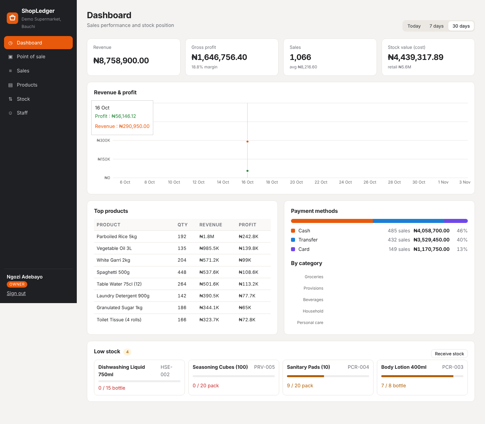
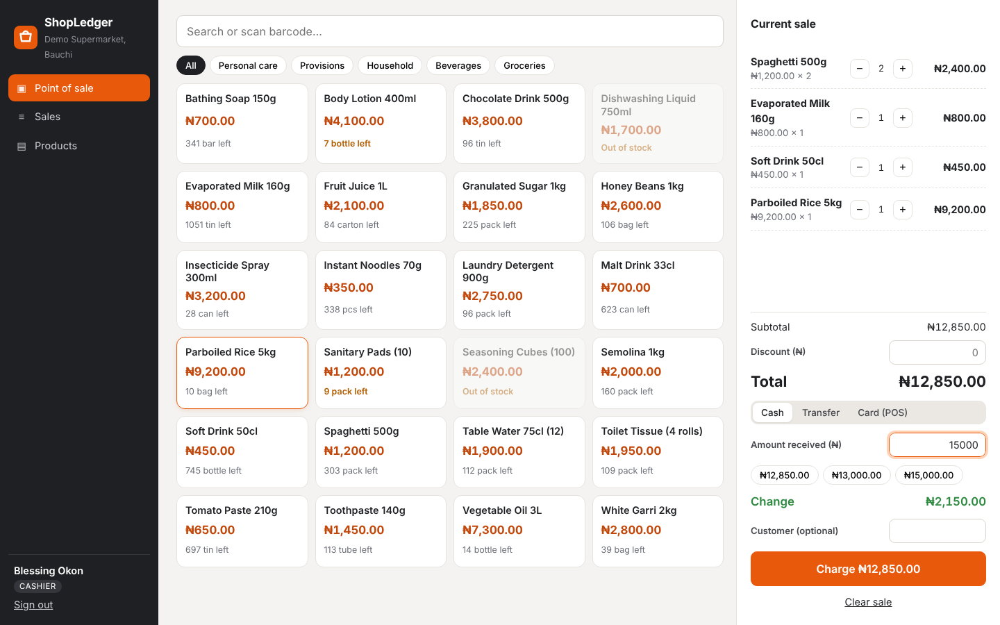
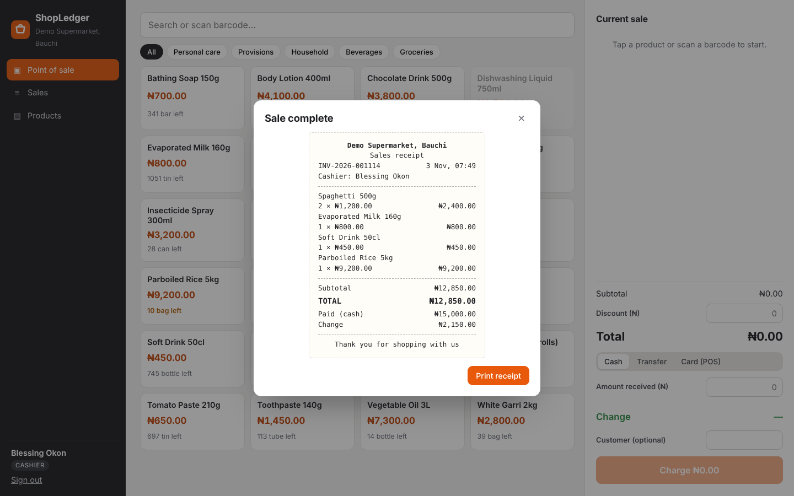
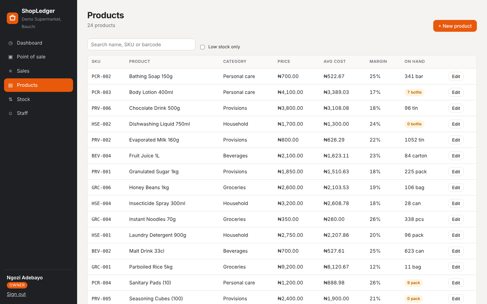
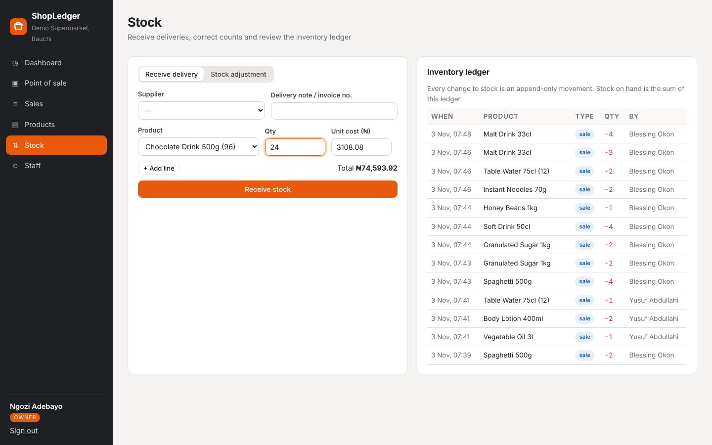
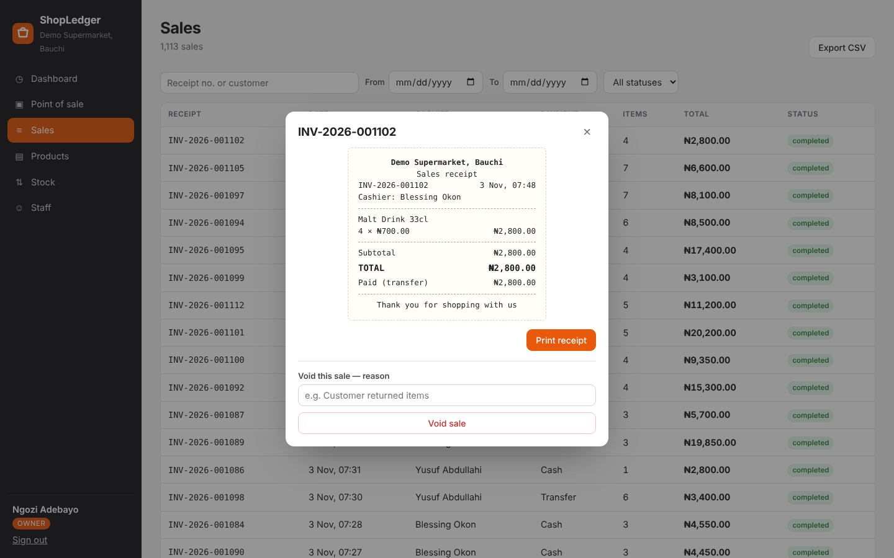
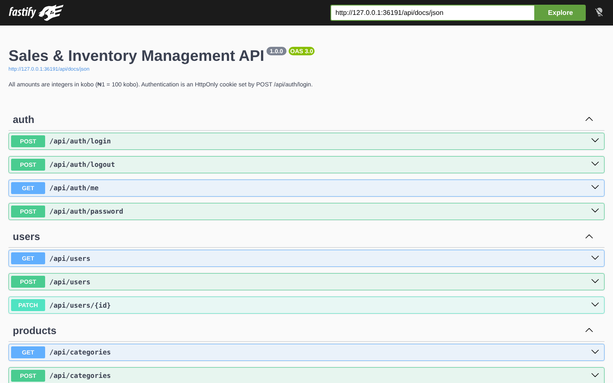

# ShopLedger — Sales & Inventory Management System

A point-of-sale, inventory and reporting system for small and medium retail shops in Nigeria: supermarkets, provision stores, pharmacies and wholesalers.

Cashiers sell from a fast touch- and barcode-friendly till. Managers receive deliveries, correct stock counts and void sales. Owners see revenue, **real gross profit** and stock value. Every unit of stock is traceable through an append-only ledger.

**Stack:** TypeScript · Fastify 5 · Zod · SQLite · React 19 · Vite · Recharts · Vitest · Docker · GitHub Actions




## Why

Most small Nigerian shops track sales in a notebook or spreadsheet and count stock at month end. Owners cannot tell their actual profit, because the price they paid for goods keeps changing. Stock "disappears" with no record of who changed what, and cashiers' totals are hard to reconcile. ShopLedger addresses each of those:

| Problem | How ShopLedger handles it |
|---|---|
| "How much profit did I make?" | Each sale line records the **cost at the moment of sale** (weighted-average cost), so profit stays correct even after supplier prices change |
| Stock doesn't add up | Stock is never edited directly. It is the **sum of an append-only ledger** of opening stock, deliveries, sales, voids and adjustments, each with who and when |
| Overselling | Sales are checked against stock inside a database transaction; one bad line rolls back the whole sale |
| Cashier fraud | Prices come from the server, never the till. Cashiers cannot see cost prices, void sales, or see other cashiers' sales. Large discounts need a manager |
| Reordering too late | Per-product reorder levels with a low-stock panel on the dashboard |

## Features

**Point of sale**
- Product grid with category filters and search; **barcode scanners work out of the box** (scan → Enter adds the item)
- Live remaining-stock on each tile; out-of-stock items are disabled
- Cash, bank transfer and card (POS terminal) payments; quick-cash buttons and automatic change
- Discounts, optional customer name, and a printable 80 mm thermal-style receipt

**Inventory**
- Products with SKU, barcode, category, unit, selling price and reorder level
- **Receive deliveries** from suppliers with multiple lines; cost price updates as a weighted average: `(on hand × old cost + qty × new cost) ÷ (on hand + qty)`
- **Stock adjustments** from a physical count, with a mandatory reason; cannot go negative
- Full movement ledger: opening, receive, sale, void, adjust

**Sales and reporting**
- Sales history with search, date and status filters, pagination and CSV export
- Void with reason, which returns items to stock through the ledger and can't be done twice
- Dashboard for Today / 7 days / 30 days:
  - KPIs: revenue, gross profit and margin, number of sales, average sale, stock value at cost and retail
  - Charts: daily revenue and profit, payment-method split, sales by category
  - Top products by revenue and profit, and the low-stock list

**Users and security**
- Three roles enforced on the server: **owner** (everything, staff management), **manager** (stock, voids, reports), **cashier** (sell, view own sales)
- JWT in an `HttpOnly`, `SameSite=Strict` cookie; every request re-checks the user in the database, so disabling a user or changing a password **revokes sessions immediately**
- The API accepts JSON only, so HTML forms on other sites cannot submit to it (CSRF), backed by the SameSite cookie
- bcrypt passwords, login rate limiting, Helmet security headers with a strict Content-Security-Policy
- Zod validation on every request with field-level error messages; parameterised SQL throughout
- CSV export neutralises spreadsheet formula injection
- `JWT_SECRET` is required in production; nothing secret is committed

**Engineering**
- Money is stored as **integer kobo** — no floating-point rounding errors
- **OpenAPI 3 documentation** generated from the Zod schemas, browsable at `/api/docs`
- 27 API tests (Vitest + Fastify inject) against an in-memory database
- Multi-stage Docker build; CI type-checks, tests and builds on Node 22 and 24

## Screenshots

| | |
|---|---|
|  **Point of sale** — cart, change calculation, low-stock and out-of-stock tiles |  **Receipt** after completing a sale |
|  **Products** with average cost and margin |  **Receive delivery** and the inventory ledger |
|  **Sales history** with void option |  **OpenAPI docs** generated from Zod schemas |

Mobile layout: [`docs/screenshots/08-mobile-dashboard.png`](docs/screenshots/08-mobile-dashboard.png)

## Quick start

Requires **Node.js 22+**.

```bash
git clone https://github.com/Elscorpio96/sales-inventory-management-system.git
cd sales-inventory-management-system
npm install
npm run seed                      # fictional supermarket with 30 days of sales
npm run dev                       # API on :4000, web on http://localhost:5173
```

To show the demo accounts on the sign-in page, start the web app with `VITE_DEMO=1` (for example `VITE_DEMO=1 npm run dev -w web`). On Windows run `npm run dev -w server` and `npm run dev -w web` in two terminals.

| Role | Email | Password |
|---|---|---|
| Owner | `owner@demo.shop` | `Owner@12345` |
| Manager | `manager@demo.shop` | `Manager@123` |
| Cashier | `cashier@demo.shop` | `Cashier@123` |

These accounts exist only in the seeded demo database. A guided walkthrough is in [`docs/DEMO.md`](docs/DEMO.md).

## Production

### Single server (Node)

```bash
npm ci
npm run build                     # builds web/dist and server/dist
cp .env.example server/.env       # set JWT_SECRET, BUSINESS_NAME, TZ
cd server
OWNER_NAME="Shop Owner" OWNER_EMAIL=owner@myshop.ng OWNER_PASSWORD='a-long-password' npm run create-owner
NODE_ENV=production JWT_SECRET=... node dist/index.js
```

The server serves the built React app and the API from one port. On a shop LAN, other tills open `http://<server-ip>:4000`.

### Docker

```bash
export JWT_SECRET=$(node -e "console.log(require('crypto').randomBytes(32).toString('hex'))")
docker compose up -d --build
docker compose exec shopledger sh -c 'OWNER_NAME="Owner" OWNER_EMAIL=owner@myshop.ng OWNER_PASSWORD="a-long-password" node dist/db/create-owner.js'
```

Data persists in the `shopledger-data` volume. Put HTTPS in front (Caddy, Nginx or your host's proxy) and set `TRUST_PROXY=1`.

### Configuration

| Variable | Default | Notes |
|---|---|---|
| `JWT_SECRET` | random in dev | **Required in production**, ≥ 32 characters |
| `PORT` / `HOST` | `4000` / `0.0.0.0` | |
| `DB_PATH` | `./data/inventory.db` | Single SQLite file — back it up daily |
| `BUSINESS_NAME` | `Demo Supermarket` | Shown in the app and on receipts |
| `SESSION_HOURS` | `12` | Sign-in lifetime |
| `TRUST_PROXY` | `0` | `1` behind a reverse proxy |
| `TZ` | system | Reports group sales by local day, e.g. `Africa/Lagos` |
| `WEB_DIST` | `../web/dist` | Location of the built React app |

## Architecture

```
server/                         Fastify API (TypeScript, ESM)
  src/app.ts                    App factory: security headers, OpenAPI, error handling, SPA fallback
  src/plugins/auth.ts           JWT cookie sessions, revocation, role guards
  src/modules/routes.ts         Every route with its Zod schema and required role
  src/modules/sales/            Sale creation and voiding (transactions)
  src/modules/inventory/        Stock ledger, deliveries, weighted-average cost, adjustments
  src/modules/reports/          Revenue, profit, payment, category and inventory reports
  src/db/schema.sql             Tables, constraints, product_stock view, indexes
  src/db/seed.ts                Deterministic 30-day demo dataset
  test/                         Vitest suites
web/                            React 19 SPA (Vite)
  src/pages/                    POS, Dashboard, Products, Stock, Sales, Staff, Login
  src/api.ts                    Typed fetch wrapper, naira/kobo helpers
scripts/screenshots.mts         Playwright screenshots of the running app
```

**Key decisions**

- **Ledger, not a stock column.** `stock_movements` is append-only, and stock on hand is the `product_stock` view summing it. There is no stored balance that can drift, and every unit has an audit trail. At small-shop scale (tens of thousands of movements) an indexed `SUM` is instant. A larger deployment would add periodic snapshots.
- **SQLite with serialised writes.** better-sqlite3 transactions are synchronous and SQLite allows one writer at a time, so the stock check and deduction in `createSale` are atomic without application-level locks. One file is easy for a shop to back up.
- **Integer kobo everywhere** in the database and API; conversion to naira happens only in the UI.
- **Schema-first API.** Zod schemas validate requests, provide TypeScript types and generate the OpenAPI document, so they cannot disagree.
- **Server-enforced roles.** The UI hides what a role can't do, but every rule is enforced by the API and covered by tests.

## Testing

```bash
npm test            # 27 API tests
npm run typecheck   # server and web, TypeScript strict mode
```

The tests cover:

- **Stock maths:** weighted-average cost, adjustments that can't go negative, voids returning stock through the ledger
- **Sales integrity:** server-side pricing, change calculation, rejected underpayment and over-large discounts, merged duplicate lines, whole-sale rollback when one line fails
- **Profit:** uses historical cost, not today's cost
- **Validation:** field-level error details, integer-only money, duplicate SKUs
- **Security:** cookie flags, form-encoded bodies rejected, immediate revocation on deactivation and password change, login rate limit
- **Access control:** a 403 for every action outside each role, cost-price hiding and own-sales-only for cashiers
- **Reports and export:** totals reconcile with raw sales, CSV injection is neutralised, the OpenAPI document is generated, the SPA fallback returns 404 for missing assets

## Limitations and roadmap

- **Offline tills:** the browser app needs the server reachable on the LAN. A service worker with an offline sales queue is the next step for unreliable networks.
- **Returns of part of a sale** (currently void the whole sale and re-ring).
- Purchase orders and supplier balances, multi-branch stock transfers, customer credit accounts and loyalty.
- VAT handling and fiscal receipt formats.
- Rate limiting is in-memory (fine for one server).

## Licence

[MIT](LICENSE) © 2026 Walid Bello Yakubu — Ilelah Technologies

Product names and all records in the demo data are fictional.
